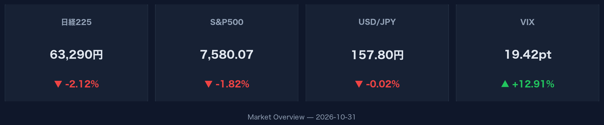
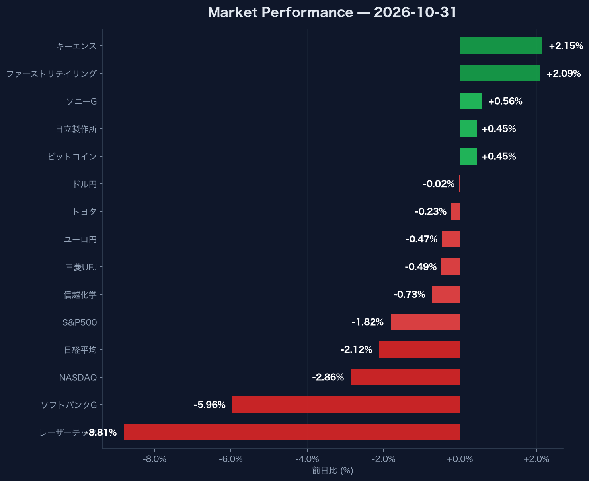

## この記事で分かること

- **米ハイテク安とVIX急騰（19.42）が指し示すリスクオフの全体像**
- **日経平均2.12%安の背景にある半導体・大型株の下落構造**
- **全面安局面でも買われる銘柄（キーエンス+2.15%等）と暗号資産の底堅さ**

## 米国ハイテク株全面安とVIX急騰が重要な理由

米国市場における主要指数の急落は、グローバルなリスクオフの直接的なシグナルです。

2026年10月31日の市場では、NASDAQが前日比2.86%安の25,437.00、S&P500が1.82%安の7,580.07と大幅に下落しました。市場の不確実性が急高下したことで、VIX（恐怖指数）は前日比+12.91%と急増し、19.42に達しています。

あわせて米10年国債利回りは1.20%低下の4.93%となり、株式から債券などの安全資産への資金逃避が明確にデータへ表れています。

:::message
VIXが19台まで急上昇する局面では、アルゴリズム取引や機関投資家の機械的なリスク削減が発動しやすくなります。ハイテク株比率が高いポートフォリオはボラティリティへの即座の警戒が必要です。
:::

:::details 米国マクロ指標の詳細データ
- **NASDAQ**: 25,437.00（前日比-2.86%）
- **S&P500**: 7,580.07（前日比-1.82%）
- **VIX指数**: 19.42（前日比+12.91%）
- **米10年国債利回り**: 4.93%（前日比-1.20%）
:::

## 日本市場における半導体・大型株集中下落の落とし穴

日経平均株価の2.12%安（63,290.11）は、一部のハイテク・大型株の急落が主因となっています。

個別銘柄では、半導体関連のレーザーテックが前日比-8.81%（37,700.00円）、ソフトバンクGが-5.96%（4,481.00円）と大きく売り込まれ、指数全体を強力に押し下げました。信越化学（-0.73%/5,966.00円）、三菱UFJ（-0.49%/3,447.00円）、トヨタ（-0.23%/3,070.00円）も軟調に推移しています。

市場全体が全面安に見える局面であっても、原因が特定セクターのボラティリティ集中にある場合、銘柄選別による回避が可能です。

:::message
レーザーテック（-8.81%）のような高ベータ銘柄の急急落時は、日経平均全体のパーセンテージだけに惑わされず、セクターごとの寄与度を切り分けて判断しなければなりません。
:::

## 為替安定と個別銘柄の逆行高を見極める方法

市場全般の心理悪化時においても、すべてのリスク資産から資金が流出しているわけではありません。

為替市場ではドル円が157.80（-0.02%）、ユーロ円が175.65（-0.47%）と小幅な変動にとどまりました。また暗号資産市場のビットコイン（BTC-USD）は前日比+0.45%高の77,548.10ドル、出来高12,875,255,808を記録して高い底堅さを示しています。

さらに日本市場の個別株でも、キーエンスが+2.15%（78,000.00円）、ファーストリテイリングが+2.09%（75,340.00円）、ソニーGが+0.56%（3,958.00円）、日立製作所が+0.45%（5,094.00円）と買われており、資金の移動先が明確に分かれています。

:::details 為替・暗号資産・個別上昇銘柄の詳細データ
- **ドル/円**: 157.80（前日比-0.02%）
- **ユーロ/円**: 175.65（前日比-0.47%）
- **ビットコイン（BTC-USD）**: 77,548.10ドル（前日比+0.45% / 出来高 12,875,255,808）
- **主な上昇銘柄**: キーエンス（+2.15
