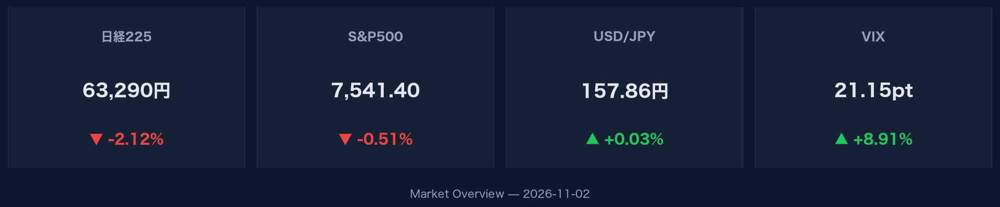
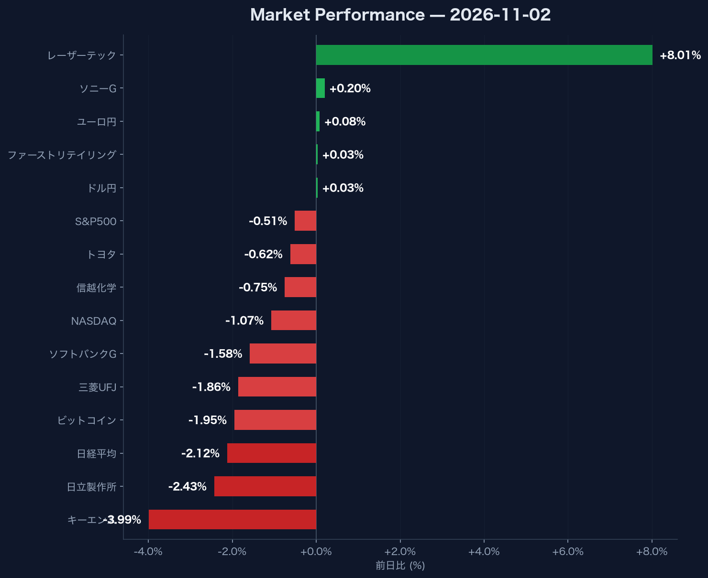

# VIX指数21突破でリスク回避が加速した2026年11月2日市場データの重要指標

## この記事で分かること
- **VIX指数8.91%急増が示唆するグローバル市場のリスク回避シグナル**
- **日経平均2.12%安の中でレーザーテックが8.01%急伸した主要銘柄の明暗**
- **ドル円157.86円の小幅動向と米10年債利回り4.89%から読み解く市場環境**

## グローバル市場全体でリスク回避姿勢を優先すべき理由

日米の主要株式指数が揃って下落し、市場のボラティリティを示す指数が急上昇したことで、グローバル全体でリスクオフの姿勢が鮮明になっています。

米国株式市場では、S&P500が前日比0.51%安の7,541.40、NASDAQが1.07%安の25,164.32とともに売られました。投資家心理の冷え込みを示すVIX指数は前日比8.91%急増して21.15に達しており、市場の不確実性が高まっています。

米10年国債利回りは0.71%低下して4.89%となり、安全資産とされる国債へ資金が流出しました。リスク資産である暗号資産市場でもビットコインが1.95%安の76,722.04ドルに落とし込んでいます。市場全体でリスク資産からの撤退が進んでいるため、短期的には慎重なポートフォリオ管理が求められる局面です。

:::message
VIX指数が20を超えて21.15まで急上昇した局面では、株価の下振れリスクが高まります。リスク資産のレバレッジ調整や現金比率の見直しを即座に行うことが重要です。
:::

## 日本市場で銘柄ごとの明暗を見極める方法

日本市場は全面安の展開となりましたが、特定の個別銘柄には強い買いが集まっており、銘柄ごとの選別を行うことが重要です。

日経平均株価は前日比2.12%安の63,290.11と大幅に続落して引け、出来高は1億7,510万株となりました。主要銘柄の多くが売られており、キーエンスが3.99%安の74,890.00円、日立製作所が2.43%安の4,970.00円、三菱UFJが1.86%安の3,383.00円と大きく値を下げました。さらにソフトバンクGが1.58%安（4,410.00円）、信越化学が0.75%安（5,921.00円）、トヨタが0.62%安（3,051.00円）と主要株が相次いで下落しています。

一方で、半導体関連のレーザーテックは前日比8.01%高の40,720.00円と急伸しました。また、ソニーGが0.20%高（3,966.00円）、ファーストリテイリングが0.03%高（75,360.00円）とプラス圏を維持しています。指数の下落に引きずられず強い資金流入がある銘柄を把握することが、全体相場崩壊時の反発候補を特定する上で重要になります。

:::details 2026年11月2日 日本市場主要銘柄の騰落データ一覧
| 銘柄名 | 株価（円） | 前日比（%） | 騰落傾向 |
| :--- | :--- | :--- | :--- |
| レーザーテック | 40,720.00 | +8.01% | 急伸 |
| ソニーG | 3,966.00 | +0.20% | 小幅高 |
| ファーストリテイリング | 75,360.00 | +0.03% | 横ばい圏 |
| トヨタ | 3,051.00 | -0.62% | 下落 |
| 信越化学 | 5,921.00 | -0.75% | 下落 |
| ソフトバンクG | 4,410.00 | -1.58% | 下落 |
| 三菱UFJ | 3,383.00 | -1.86% | 下落 |
| 日立製作所 | 4,970.00 | -2.43% | 下落 |
| キーエンス | 74,890.00 | -3.99% | 大幅安 |
:::

## 為替市場の動向から株価下落の要因を切り分ける方法

株価の下落に対して為替相場がほぼ横ばいで推移している場合、今回の下落は為替要因ではなく株式市場独自のリスクオフに起因していると判断できます。

為替市場では小幅な動きにとどまりました。ドル円（USD/JPY）は前日比0.03%高の157.86円付近でほぼ横ばいの推移となっています。ユーロ円（EUR/JPY）も前日比0.08%高の176.62円と限定的な動きでした。

急激な円高による日本株の押し下げではないため、今回の相場下落はグローバルな株式市場における投資家心理の冷え込みが主因であると整理できます。要因を正確に切り分けることで、過度な狼狽売りを避け、適切な投資判断を下すことが可能になります。

## まとめ

- **VIX指数が8.91%増の21.15へ急増し、米国市場（S&P500 -0.51%、NASDAQ -1.07%）を中心にリスク回避が加速**
- **日経平均株価は2.12%安の63,290.11と全面安の中、レーザーテックが8.01%高と独歩高の展開**
- **ドル円は157.86円（+0.03%）と横ばいであり、今回株安の主因は為替ではなく株式市場固有のリスクオフ**

**次に何をすべきか：**
VIX指数が21を超えたため、保有資産内の高ボラティリティ銘柄のポジションサイズを縮小し、リスク許容度を超えた運用になっていないか再チェックを行ってください。
