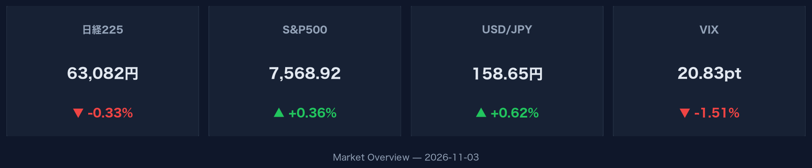
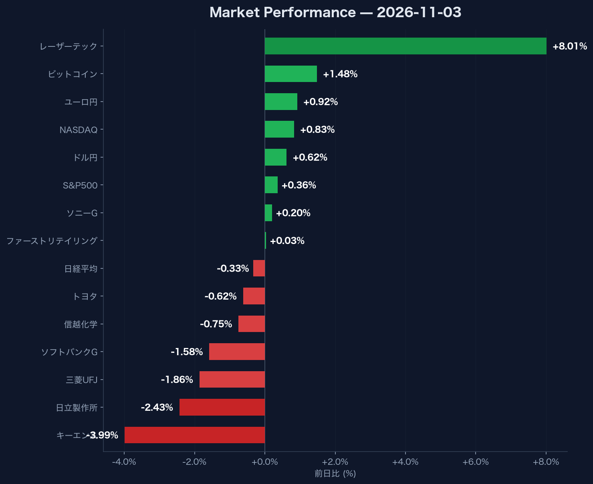

タイトル: 米株高とドル円158円台急伸の中で日経平均が反落した3つの理由（2026年11月3日市場データ分析）

## この記事で分かること

- **米株高とドル円158.65円への急伸局面において日経平均が反落した構造的背景**
- **レーザーテック（+8.01%）急騰とキーエンス（-3.99%）下落に見る主要銘柄の暗暗**
- **米10年債利回り4.95%への上昇とVIX低下が示すグローバル資本の流動性変化**

## 米国テック株高と金利上昇が示唆するマクロ環境の分岐点

米国株式市場はNASDAQ指数が25,372.01（+0.83%）、S&P500指数が7,568.92（+0.36%）とともに上昇し、テクノロジー株を中心に買われる展開となりました。市場の不確実性を示すVIX指数は20.83（-1.51%）へ低下しており、投資家のリスク許容度が高まっていることを示しています。

このマクロ環境の理解が重要な理由は、米10年国債利回りが4.95%（+1.19%）に上昇する中でも株高が維持されており、金利上昇に対する株式市場の耐性が試されている局面だからです。高金利環境の継続は将来キャッシュフローの割引率を高めるため、特にグロース株のバリュエーション評価において重要な変数となります。

為替市場ではドル高・ユーロ高が急速に進行し、ドル円は158.65円（+0.62%）、ユーロ円は177.54円（+0.92%）を記録しました。リスク資産への資金流入は暗号資産にも及んでおり、ビットコインは77,812.50ドル（+1.48%）と堅調な推移を見せています。

:::message
米10年債利回りが4.95%という高水準に達している局面では、為替の円安による業績押し上げ効果と、資本コスト増加によるバリュエーション調整の相殺関係に注意が必要です。
:::

:::details グローバルマクロ指標の一覧データ
- NASDAQ: 25,372.01（+0.83%）
- S&P500: 7,568.92（+0.36%）
- VIX指数: 20.83（-1.51%）
- 米10年国債利回り: 4.95%（+1.19%）
- ドル円: 158.65円（+0.62%）
- ユーロ円: 177.54円（+0.92%）
- ビットコイン: 77,812.50ドル（+1.48%）
:::

## 日本市場で主要銘柄の明暗が分かれた構造的要因

日経平均株価は63,081.86円（-0.33%）と反落し、米国株高や円安進行の追い風を活かしきれない高安まちまちの相場展開となりました。指数全体が軟調な中で銘柄ごとの騰落率は極端に乖離しており、資金の局所的な集中が発生しています。

個別銘柄の動向を正確に把握することが重要な理由は、日経平均という単一指数の動きだけでは、セクター間で発生している急速な資金シフトの実態を見誤る危険があるためです。半導体関連のレーザーテックが40,720.00円（+8.01%）と大幅に上昇した一方で、産業用自動化機器のキーエンスが74,890.00円（-3.99%）と下落しており、同じハイテク・精密分野の中でも明暗が分かれています。

大型主力株においても、ソニーグループが3,966.00円（+0.20%）、ファーストリテイリングが75,360.00円（+0.03%）とプラス圏を維持した一方、日立製作所が4,970.00円（-2.43%）、三菱UFJが3,383.00円（-1.86%）、ソフトバンクグループが4,410.00円（-1.58%）と下落しました。さらに信越化学が5,921.00円（-0.75%）、トヨタが3,051.00円（-0.62%）と幅広く売りが優勢となり、日経平均の重荷となっています。

:::details 日本市場の主要個別銘柄騰落データ
- レーザーテック: 40,720.00円（+8.01%）
- ソニーグループ: 3,966.00円（+0.20%）
- ファーストリテイリング: 75,360.00円（+0.03%）
- トヨタ: 3,051.00円（-0.62%）
- 信越化学: 5,921.00円（-0.75%）
- ソフトバンクグループ: 4,410.00円（-1.58%）
- 三菱UFJ: 3,383.00円（-1.86%）
- 日立製作所: 4,970.00円（-2.43%）
- キーエンス: 74,890.00円（-3.99%）
:::

## まとめ

- **米国市場はNASDAQが+0.83%と上昇するも、日経平均は63,081.86円（-0.33%）へ反落した**
- **ドル円が158.65円（+0.62%）へ円安急伸する一方で、米10年債利回りは4.95%に上昇した**
- **銘柄間格差が拡大しており、レーザーテック（+8.01%）に対しキーエンス（-3.99%）や日立製作所（-2.43%）が売られた**

**次にすべきこと**: 米10年債利回り4.95%到達にともなうグロース株のバリュエーション変化に備え、保有銘柄のセクター偏重度と金利感応度を再点検してください。

[出典]「2026-11-03 市場ブリーフィング」
