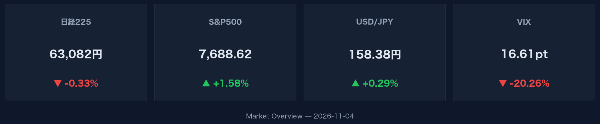
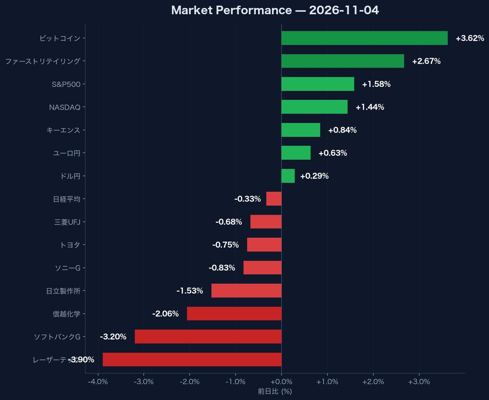

:::message
米国市場ではS&P500が+1.58%、NASDAQが+1.44%と共に上昇し、VIX指数は-20.26%と幅広くリスクオンの動きが見られました。一方で日経平均株価は-0.33%の63,081.86と小幅に反落。為替市場ではドル円が158.38円、ユーロ円が177.83円と円安傾向が続いています。
:::

## 米国市場・グローバルマクロ動向

米国株式市場は堅調な推移となりました。S&P500は前日比+1.58%の7,688.62、NASDAQ総合指数は前日比+1.44%の25,736.51で取引を終えています。市場の不確実性を示すVIX指数は16.61となり、前日比-20.26%と大幅に低下しました。米10年国債利回りは4.89%へと低下（前日比-1.17%）しています。暗号資産市場では、ビットコイン（BTC-USD）が前日比+3.62%上昇し、80,145.13ドルを記録しています。

## 為替市場の動向

為替市場では主要通貨に対して円安が進行しています。ドル円（USDJPY=X）は前日比+0.29%の158.38円、ユーロ円（EURJPY=X）は前日比+0.63%の177.83円で推移しています。

## 日本市場および個別銘柄動向

日経平均株価は前日比-0.33%の63,081.86（出来高162,800,000）となり、小幅に下落しました。個別銘柄では明暗が分かれる展開となっています。上昇した銘柄では、ファーストリテイリング（9983.T）が+2.67%（77,370.00円）、キーエンス（6861.T）が+0.84%（75,520.00円）となりました。一方、下落した銘柄ではレーザーテック（6920.T）が-3.90%（39,130.00円）、ソフトバンクG（9984.T）が-3.20%（4,269.00円）、信越化学（4063.T）が-2.06%（5,799.00円）、日立製作所（6501.T）が-1.53%（4,894.00円）と軟調でした。また、ソニーG（6758.T）は-0.83%（3,933.00円）、トヨタ（7203.T）は-0.75%（3,028.00円）、三菱UFJ（8306.T）は-0.68%（3,360.00円）で引けています。
