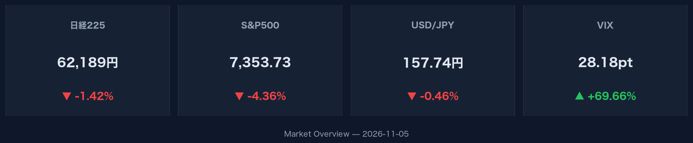
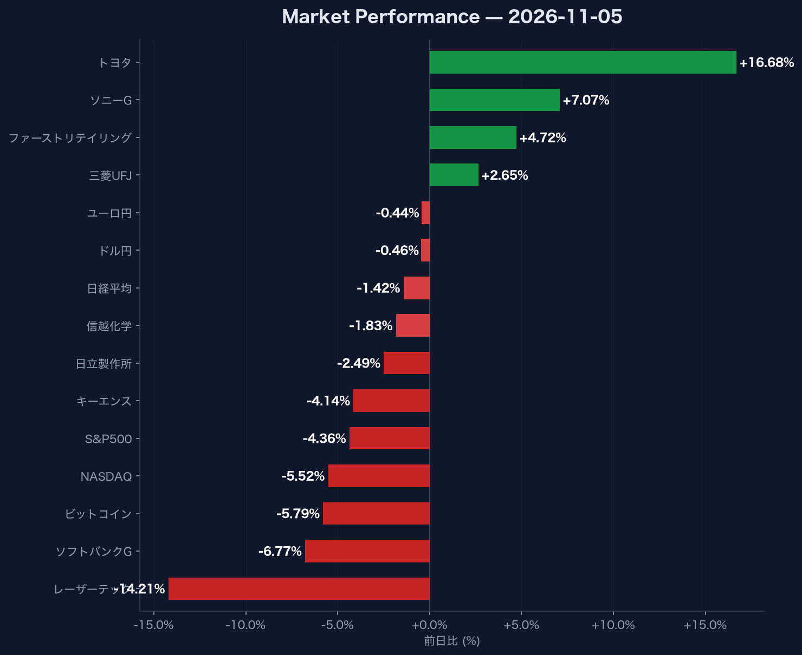

# NASDAQ-5.52%急落とVIX28超えから読み解く市場の二極化パターン

## この記事で分かること

- **米国主要指数（NASDAQ -5.52%, S&P500 -4.36%）の急落と恐怖指数の急騰が示すリスクオフの規模**
- **日本市場（日経平均 62,188.63円）における半導体銘柄の急落と大型株上昇による極端な明暗**
- **リスクオフ局面での為替（ドル円157.74円）、米債利回り、暗号資産の短期的資金フロー**

## 米国ハイテク市場の急落が直撃した理由

米国株式市場では主要指数が急落し、リスク回避の売りが急速に広がりました。S&P500は前日比-4.36%の7,353.73、NASDAQ総合指数は前日比-5.52%の24,315.00と大幅に下落しています。市場の不確実性を表すVIX指数は前日比+69.66%と大幅に跳ね上がり、28.18に達しました。

テクノロジーセクターを中心とした急激な資金引き揚げは、グローバルな市場心理に即座に影響を与えるため重要です。株式市場のみならず、リスク資産全般に売りの波及が確認できます。暗号資産のビットコイン（BTC-USD）は前日比-5.79%安の75,748.01ドルへ下落し、リスク資産全体から資金が流出しました。

:::message
VIX指数が28.18（前日比+69.66%）まで急騰している局面では、ボラティリティが非常に高くなります。市場全体の流動性変化に注意が必要です。
:::

:::details 金利と暗号資産の動きを補足データで確認する
米10年国債利回りは4.84%となり、前日比-1.16%低下しました。株式からのリスクオフに伴い国債へ資金が一部退避した動きと合致しています。一方で、暗号資産市場は株式市場のリスクオフに連動し、ビットコイン（BTC-USD）は75,748.01ドル（-5.79%）まで連安する展開となりました。
:::

## 日本市場で半導体関連が急落した落とし穴

日経平均株価は前日比-1.42%減の62,188.63円（出来高2億6,010万株）で取引を終えましたが、内部では銘柄ごとの明暗が激しく分かれました。米国ハイテク株安の波及を直接受けたのが、国内の半導体およびハイテク関連銘柄です。

グローバルサプライチェーンの中核を担う銘柄群の動向を把握することは、テクノロジー産業全体の投資センチメントを測定する上で極めて重要です。主要な下落銘柄のデータは以下の通りです。

- レーザーテック（6920.T）: 33,570.00円（前日比 -14.21%）
- ソフトバンクグループ（9984.T）: 3,980.00円（前日比 -6.77%）
- キーエンス（6861.T）: 72,390.00円（前日比 -4.14%）
- 日立製作所（6501.T）: 4,772.00円（前日比 -2.49%）
- 信越化学（4063.T）: 5,693.00円（前日比 -1.83%）

レーザーテックの-14.21%を筆頭に、ハイテク・製造業の主要銘柄に強い売り圧力がかかりました。

## 伝統的大型株への資金シフトが示唆する判断基準

指数全体には下落圧力がかかったものの、一部の大型株やバリュー株には力強い買いが入りました。日経平均の下値を支える形で、特定の主要銘柄が大幅に上昇しています。

銘柄ごとの二極化構造を把握することは、全体指数の数字だけに惑わされず正確な資金循環を判断するために不可欠です。株価が上昇した主な銘柄は以下の通りです。

- トヨタ自動車（7203.T）: 3,533.00円（前日比 +16.68%）
- ソニーグループ（6758.T）: 4,211.00円（前日比 +7.07%）
- ファーストリテイリング（9983.T）: 81,020.00円（前日比 +4.72%）
- 三菱UFJフィナンシャル・グループ（8306.T）: 3,449.00円（前日比 +2.65%）

トヨタ自動車が+16.68%と急伸したほか、ソニーグループや金融大手にも資金が流入しました。為替市場ではドル円が157.74円（前日比-0.46%）、ユーロ円が176.81円（前日比-0.44%）と、やや円高に振れるなかでのセクター選別が進んでいます。

## まとめ

- **米国市場の全般的なリスクオフ**: NASDAQ（-5.52%）やS&P500（-4.36%）が急落し、VIX指数は28.18（+69.66%）へ急騰。
- **日本市場における二極化の発生**: レーザーテック（-14.21%）など半導体株が急落する一方、トヨタ自動車（+16.68%）などの大型株が指数を支えた。
- **他アセットへの資金波及**: ビットコイン（-5.79%）が下落し、為替（ドル円 157.74円）は小幅な円高推移を示した。

**次に取るべきアクション**: ハイテクセクターに偏重したポートフォリオのリスク暴露度を再点検し、VIX指数28台が示すボラティリティに対応できるよう、現金の比率や分散投資の比率を確認してください。
