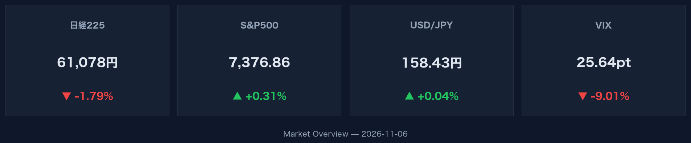
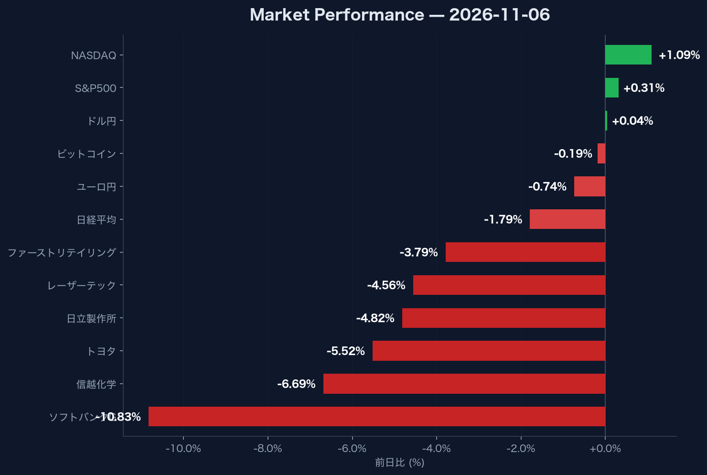

:::message
米国株式市場ではNASDAQが1.09%高と堅調に推移し、VIXは9.01%低下して25.64となりました。一方、日本市場では日経平均株価が1.79%安の61,077.90円と下落し、ソフトバンクグループ（-10.83%）や信越化学（-6.69%）など主要な大型株が大きく売られました。ドル円は158.43円で小幅高となりました。
:::

## 米国市場：NASDAQが1.09%高、VIXは25.64へ急低下

米国株式市場は上昇傾向となりました。NASDAQ総合指数は前日比+1.09%高の24,579.42、S&P500指数は+0.31%高の7,376.86で取引を終えました。市場の不確実性を示すVIX指数は-9.01%と大幅に低下し25.64となっています。また、米10年国債利回りは+0.45%上昇し4.86%となりました。

## 日本市場：日経平均が61,077.90円へ反落、主要銘柄に売り広がる

日本市場では日経平均株価が前日比-1.79%安の61,077.90円に下落しました。主要銘柄では、ソフトバンクグループが3,549.00円（-10.83%）と二桁の下落となったほか、信越化学が5,312.00円（-6.69%）、トヨタ自動車が3,338.00円（-5.52%）、日立製作所が4,542.00円（-4.82%）、レーザーテックが32,040.00円（-4.56%）、ファーストリテイリングが77,950.00円（-3.79%）と、全面安の展開となりました。

## 為替・暗号資産：ドル円は158.43円、ビットコインは微減

為替市場ではドル円が158.43円（+0.04%）と横ばい圏で推移した一方、ユーロ円は176.59円（-0.74%）と下落しました。暗号資産市場ではビットコイン（BTC-USD）が75,795.93ドル（-0.19%）で推移しています。
