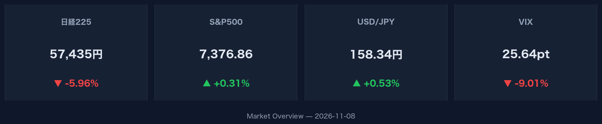
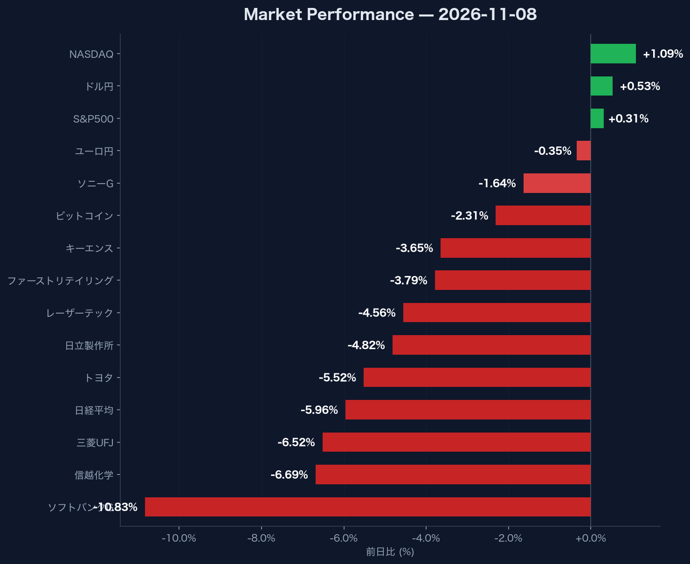

# 日経平均-5.96%急落と米ハイテク高のデカップリング：2026年11月8日市場データの構造的ポイント

## この記事で分かること
- **日経平均-5.96%急落の裏にある主力銘柄の売り圧力と下落幅の実態**
- **NASDAQ+1.09%上昇とVIX低下が示す米国市場のボラティリティ緩和傾向**
- **米10年債利回り4.86%上昇とドル円158.34円推移が及ぼすマクロ環境への影響**

## 日本株の急落に対し主要銘柄の売り圧力を把握する方法
日経平均株価が前日比-5.96%（57,434.77円、出来高3億1,400万株）へと急落した背景には、大型主力株への全面的な売り圧力があります。なぜこれが重要かというと、単一セクターにとどまらずハイテク・金融・自動車など主要銘柄全体へ下落が波及しているからです。流動性の高い主力銘柄から資金が流出する局面的特徴を示しています。

特にソフトバンクグループが3,549.00円（-10.83%）と二桁の下落となったほか、幅広い銘柄が値を下げました。主要銘柄の下落率は以下の通りです。

- 信越化学：5,312.00円（-6.69%）
- 三菱UFJ：3,224.00円（-6.52%）
- トヨタ：3,338.00円（-5.52%）
- 日立製作所：-4.82%

:::message
日経平均の5.96%下落は主力銘柄の同時安によるものです。特定地域や特定セクターへの過度な資産偏重は短期的ボラティリティの影響を直に受けるため注意が必要です。
:::
