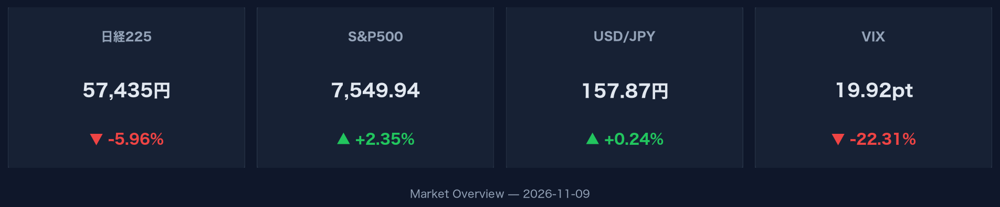
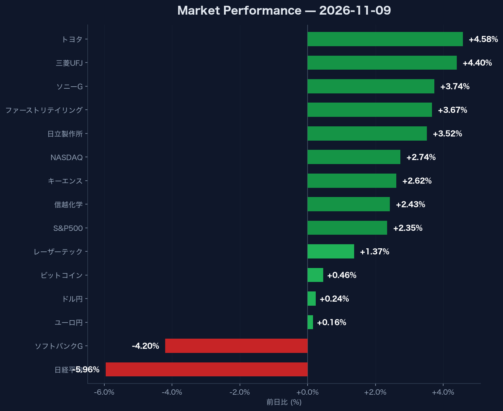

:::message
米国市場では株価が大幅に上昇し、VIX指数が急低下した一方で、日経平均株価は大幅安となりました。為替市場ではドル高・円安傾向が続いており、ドル円は157.87円で推移しています。
:::

## 米国株式市場およびリスク指標

米国主要株価指数は揃って上昇しました。S&P500は前日比+2.35%の7,549.94（出来高3,534,682,000）、NASDAQは前日比+2.74%の25,253.14（出来高8,024,730,000）で取引を終えました。市場の不確実性を示すVIX指数は19.92へと大幅低下（前日比-22.31%）しています。

## 為替・金利・暗号資産

為替市場では円安が進行し、ドル円は157.87（前日比+0.24%）、ユーロ円は177.11（前日比+0.16%）となりました。米10年国債利回りは4.86（前日比+0.10%）に上昇しています。暗号資産のビットコインは74,928.72（前日比+0.46%、出来高31,385,139,200）で推移しています。

## 日本市場および個別銘柄動向

日経平均株価は前日比-5.96%の57,434.77（出来高314,400,000）と大幅に下落しました。個別銘柄では、ソフトバンクGが3,400.00（前日比-4.20%）と下落した一方、トヨタが3,491.00（前日比+4.58%）、三菱UFJが3,366.00（前日比+4.40%）、ソニーGが4,297.00（前日比+3.74%）、ファーストリテイリングが80,810.00（前日比+3.67%）、日立製作所が4,702.00（前日比+3.52%）、キーエンスが71,580.00（前日比+2.62%）、信越化学が5,441.00（前日比+2.43%）、レーザーテックが32,480.00（前日比+1.37%）と、多くの主要銘柄はプラス圏で取引されました。
