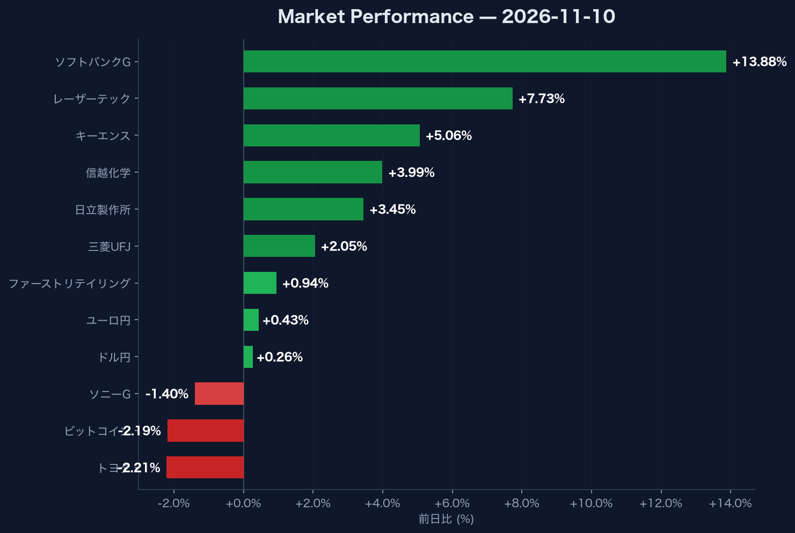

# 米金利4.98%到達とソフトバンクG+13.88%急騰から読み解くハイテク銘柄の選定基準

## この記事で分かること
- **米10年債利回り4.98%とドル円158.71円のマクロ環境がテック株式市場に与える具体的な影響**
- **ソフトバンクG（+13.88%）やレーザーテック（+7.73%）に資金が集中しトヨタやソニーが売られた選別基準**
- **VIX指数19.46への低下とBTC下落（73,578.19ドル）の非同期から見抜くリスク管理の判断手法**

## マクロ金利と為替の連動をポートフォリオの外部変数として捉える方法

米10年国債利回りが4.98%まで上昇し、ドル円は158.71円に達したため、マクロ指標の変動が株式市場の資金シフトを直接引き起こしています。

ドル円は前日比+0.26%の158.71円、ユーロ円は前日比+0.43%の177.21円と、依然として円安・ドル高のトレンドが持続しています。米10年国債利回りが前日比+2.45%急増して4.98%に達したことは、高金利環境の定着を示唆する重要なシグナルです。一方で、不確実性を示すVIX指数は19.46（前日比-2.31%）へと低下しており、市場全体のボラティリティ警戒感自体は和らいでいます。

この動向が重要な理由は、米金利4.98%という水準がグロース株に対する評価倍率（マルチプル）の抑制要因となる一方で、158.71円の円安水準がグローバルテック企業の収益を強力に下支えするトレードオフの関係にあるためです。

:::message
金利上昇（米10年債4.98%）と円安（ドル円158.71円）が同時進行する局面では、グロース株全般を一括で扱うのではなく、各企業のキャッシュフロー創出力と価格転嫁力を見極める必要があります。
:::

## ハイテク・半導体関連株の選別買いを見極める重要性

高金利下にもかかわらず、半導体・精密機器関連株に強い買戻しが入った背景には、事業ポートフォリオと付加価値構造の差が存在します。

個別銘柄ではソフトバンクグループ（9984.T）が前日比+13.88%（3,872.00円）と
