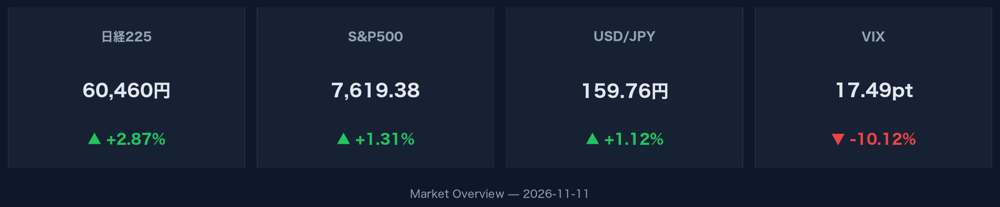
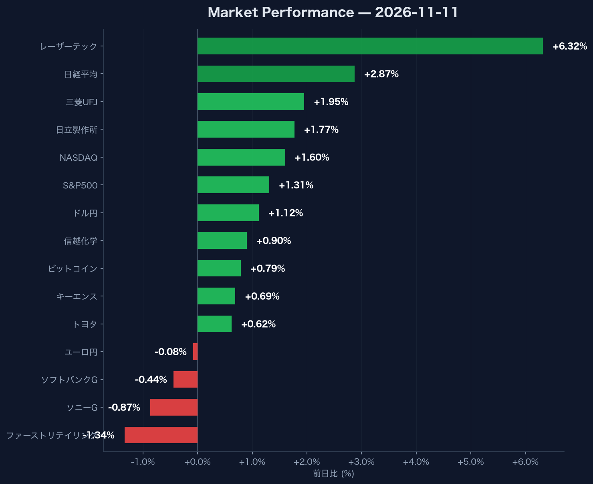

# 日経6万突破・米金利5.0%到達時の市場データまとめ：2026年11月11日の市況と銘柄動向

## この記事で分かること
- **主要指数（日経・S&P500・NASDAQ）の同時急騰とVIX低下によるリスク選好の背景**
- **ドル円159.76円および米10年債利回り5.00%到達におけるマクロ環境の数値**
- **レーザーテック（+6.32%）をはじめとする日本株主要銘柄の明確な資金選別傾向**

## グローバル指数の急騰とリスクオン転換を見極める方法

日米の主要指数が揃って大幅高となり、市場のボラティリティ警戒感は急低下しています。

日経平均株価は前日比+2.87%（+1,685.25相当）と大幅に伸長し、60,459.58で取引を終了しました。当日の出来高は176,100,000株に達しています。米国市場においても、S&P500が7,619.38（+1.31%）、NASDAQが25,466.19（+1.60%）と高値圏で推移しました。恐怖指数とされるVIXは17.49まで前日比-10.12%低下しました。

なぜこれが重要か：株式指数の水準とVIXの動きをセットで追うことで、一時的な買戻しなのか持続的なリスク許容度の高まりなのかを客観的に判断できるからです。

:::message
VIX指数が17.49へ低下したことは、市場参加者の警戒感が和らぎ、グローバル市場全体でリスクオンの動きが強まっていることを意味します。
:::

:::details 主要指数の詳細データ
- 日経平均株価: 60,459.58 (前日比 +2.87% / +1,685.25相当, 出来高 176,100,000株)
- S&P500: 7,619.38 (前日比 +1.31%)
- NASDAQ: 25,466.19 (前日比 +1.60%)
- VIX指数: 17.49 (前日比 -10.12%)
:::

## 為替・金利・暗号資産の連動性を評価する重要性

米10年国債利回りが5.00%に達する中、為替市場では顕著なドル高・円安が進行しています。

為替市場のドル円は159.76（前日比+1.12%）へ上昇し、大幅な円安となりました。一方でユーロ円は177.15（前日比-0.08%）と微減にとどまっており、通貨ペアによる方向性の違いが明確です。米10年国債利回りは5.00（前日比+0.30%）へ上昇しました。暗号資産市場では、ビットコイン（BTC-USD）が
