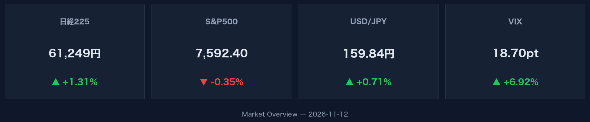
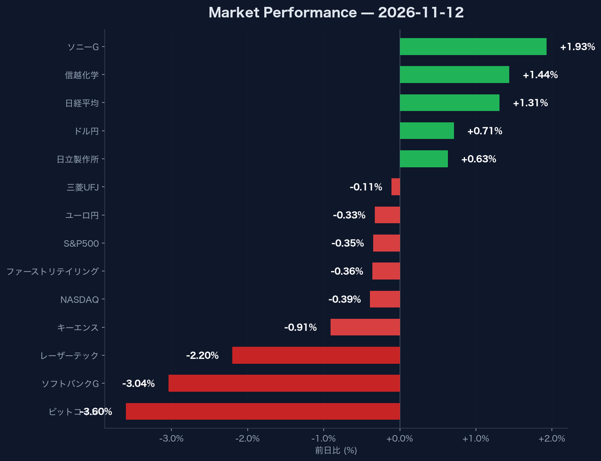

:::message
2026年11月12日の市場では、日経平均株価が前日比+1.31%の61,248.59へ上昇した一方、米国市場はS&P500が-0.35%、NASDAQが-0.39%と下落しました。米10年国債利回りが5.10（+2.10%）へ上昇し、VIX指数も18.70（+6.92%）に上昇してボラティリティが高まっています。ドル円は159.84（+0.71%）と円安・ドル高傾向を示しています。
:::

## 米国主要指数と金利動向

米国株式市場では、S&P500が前日比-0.35%の7,592.40（出来高 3,182,097,000）、NASDAQ総合指数が-0.39%の25,366.09（出来高 8,814,571,000）となり、揃って反落しました。背景には米10年国債利回りが5.10まで上昇（前日比+2.10%）したことが重しとなっています。市場の警戒感を示すVIX指数も18.70へと前日比+6.92%上昇しました。

## 為替・暗号資産市場の動き

為替市場において、ドル円は159.84と前日比+0.71%上昇し、ドル高・円安の動きを見せています。一方でユーロ円は前日比-0.33%の176.67と上昇が一服しました。暗号資産市場では、ビットコイン（BTC-USD）が71,303.35ドルとなり、前日比-3.60%と下落しました（出来高 27,777,705,984）。

## 日本市場・個別銘柄の動向

日本市場では、日経平均株価が前日比+1.31%の61,248.59（出来高 193,200,000）と堅調な展開となりました。主要銘柄を見ると、ソニーG（6758.T）が4,281.00円（+1.93%）、信越化学（4063.T）が5,791.00円（+1.44%）、日立製作所（6501.T）が4,981.00円（+0.63%）と上昇しました。一方で、ソフトバンクG（9984.T）が3,738.00円（-3.04%）、レーザーテック（6920.T）が36,380.00円（-2.20%）、キーエンス（6861.T）が75,030.00円（-0.91%）、ファーストリテイリング（9983.T）が80,190.00円（-0.36%）、三菱UFJ（8306.T）が3,498.00円（-0.11%）と下落し、銘柄間で高安が分かれる展開となっています。
