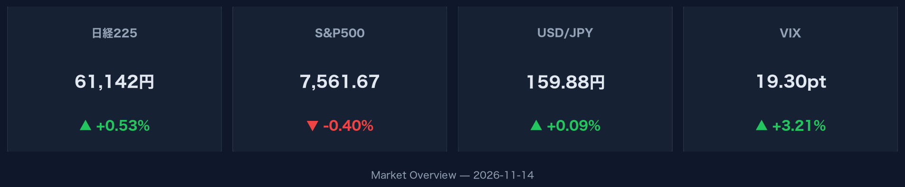
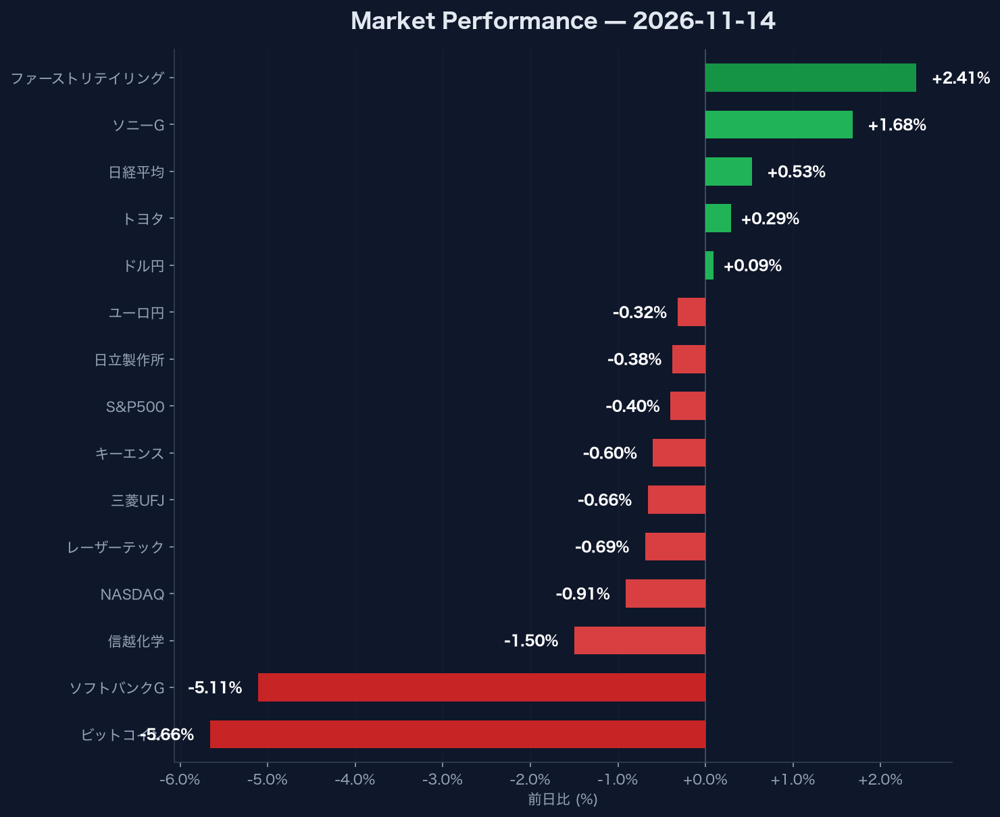

米利回り5.15%突破とBTC急落から読み解く、2026年11月14日の市場データとリスク管理の判断基準

## この記事で分かること

- **日経平均が61,000円台を維持する一方で米ハイテク株が下落した構造的要因**
- **米10年国債利回り5.15%とVIX 19.30到達が示すリスク資産からの資金流出メカニズム**
- **ファーストリテイリングやソフトバンクGなど主要個別銘柄に見る資金シフトの判断指標**

## 日経平均61,000円台維持と米株安の乖離を判別する方法

日米市場におけるパフォーマンスの差は、為替動向と指数牽引銘柄の寄与度を個別に分解して評価する必要があります。米国市場ではハイテク株を中心に売りが先行し、NASDAQが25,136.27（前日比-0.91%）、S&P500が7,561.67（-0.40%）と揃って下落しました。これに対して日経平均株価は、出来高1億4,500万株のもと前日比+0.53%の61,142.35円と堅調な動きを見せ、61,000円台を維持しています。

この乖離を分析する上で最も重要な指標は為替の動きです。ドル円が159.88（+0.09%）と小幅にドル高・円安方向へ振れたことが、日本株全体の底固さを支える要因となりました。一方でユーロ円は176.66（-0.32%）と円高・ユーロ安で推移しており、通過ペアごとの選択的な資金フローが発生していることが分かります。

市場全体の方向性を判断する際には、表面的な株価指数のプラス・マイナスだけに依存せず、為替感応度を組み合わせた評価を行うことが重要です。

:::message
米国ハイテク株の下落局面において、ドル円が159円台後半で維持されている期間は、日経平均の下げ幅が限定的になりやすい点に注意が必要です。ただし、金利高に伴う世界的なボラティリティ上昇局面では、急激な巻き戻しへの警戒を怠るべきではありません。
:::

## 米10年金利5.15%上昇とBTC急落からリスクオフを見極める理由

米10年国債利回りの上昇と恐怖指数の急伸が重なる局面では、暗号資産をはじめとする高ボラティリティなリスク資産からの資金引き揚げが加速します。米10年国債利回りは5.15（前日比+1.00%）へ上昇し、金利高が株式市場およびリスク資産全体の明確な重しとなっています。同時に、市場の警戒感を示すVIX指数は19.30（+3.21%）へと急上昇しました。

このマクロ環境の変化に対して最も敏感に反応したのが暗号資産市場です。ビットコイン（BTC-USD）は前日比-5.66%の大幅安となり、64,384.28ドルまで急落しました（出来高：39,656,116,224）。無リスク資産である国債の利回りが5%を超える局面では、期待リターンに対するリスク比率が見合わなくなり、資金が資本効率の観点から急速に避難するため、このデータの確認が重要です。

:::details 金利とリスク資産の関係性についての深掘り
金利（米10年債利回り5.15%）の上昇は、将来キャッシュフローの割引率を高めるため、特に高バリュエーションのハイテク株（NASDAQ -0.91%）や配当・キャッシュフローを生み出さない暗号資産（ビットコイン -5.66%）に対して強力な売り圧力として作用します。VIX指数が19.30まで切り上がったことは、投資家がダウンサイドリスクに対するヘッジ需要を急速に高めている証左です。
:::

## 主要個別銘柄の明暗を分けるスクリーニングの基準

同質の市場環境であっても、銘柄のビジネスモデルとグローバルな投資キャッシュフローへの露出度によって株価の明暗がはっきりと分かれます。日経平均の上昇を牽引したのは、ファーストリテイリングの82,120.00円（+2.41%）やソニーGの4,353.00円（+1.68%）、トヨタの3,418.00円（+0.29%）といった大型ハードウェア・消費関連銘柄でした。

対照的に、ハイテク投資ファンドとしての側面が強いソフトバンクGは3,547.00円（-5.11%）と大幅に売り込まれました。また、半導体・精密機器・金融関連の主要銘柄も軒並み軟調な推移を見せています。

- 信越化学: 5,704.00円（-1.50%）
- レーザーテック: 36,130.00円（-0.69%）
- 三菱UFJ: 3,475.00円（-0.66%）
- キーエンス: 74,580.00円（-0.60%）
- 日立製作所: 4,962.00円（-0.38%）

金利上昇局面では、グローバルなハイテク成長株ポートフォリオを持つ銘柄ほどボラティリティが大きくなるため、個別銘柄のファンダメンタルズと金利感応度を個別に判定することが不可欠です。

## まとめ

- **日経平均は61,142.35円（+0.53%）と61,000円台を維持したが、米NASDAQは-0.91%とハイテク株を中心に下落した**
- **米10年金利が5.15%に上昇しVIXが19.30へ跳ね上がったことで、ビットコイン（-5.66%）などリスク資産から資金が流出した**
- **ファーストリテイリング（+2.41%）が指数を支えた一方、グローバル投資色の強いソフトバンクG（-5.11%）は大幅安となった**

**次に何をすべきか：**
保有ポートフォリオにおける「米金利感応度の高いハイテク・暗号資産銘柄」の比率を再点検し、VIX 19.30到達を踏まえたリスク許容度の調整を行ってください。

[出典] [市場ブリーフィング]「2026-11-14 日経平均・米国市場・暗号資産動向」
