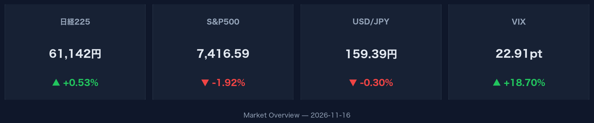
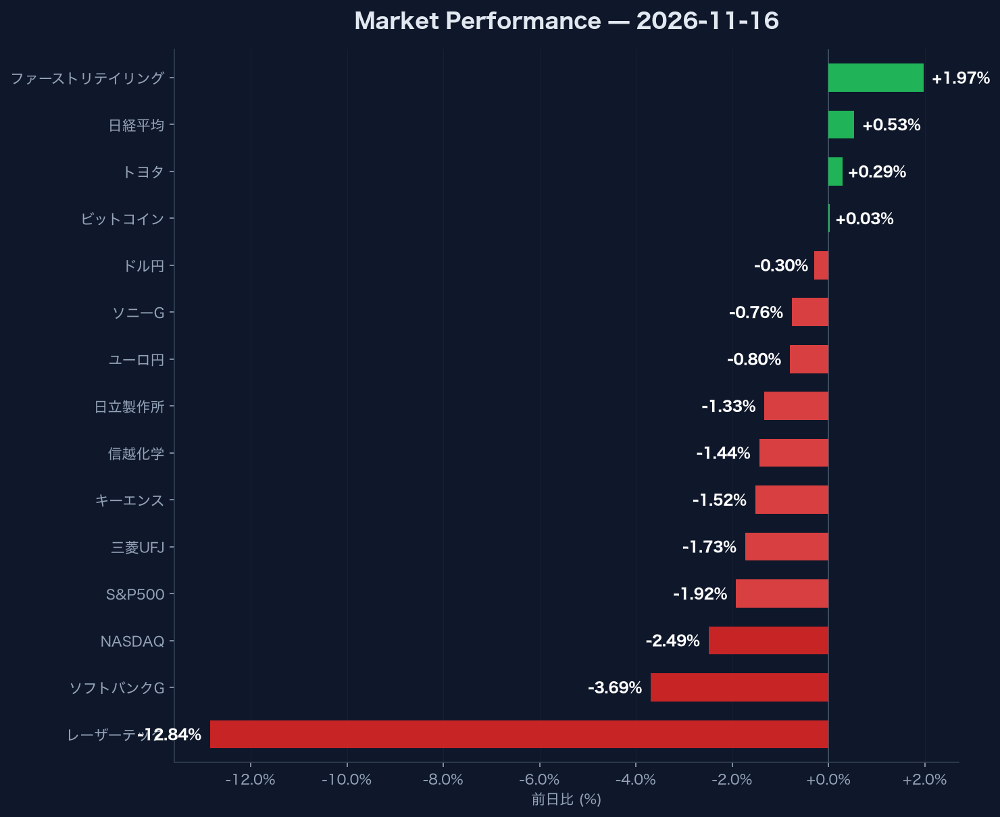

:::message
米国株式市場はハイテク株を中心に下落し、NASDAQが-2.49%、S&P500が-1.92%となったほか、VIX指数が22.91（+18.70%）と大幅に上昇しました。一方、日経平均は61,142.35（+0.53%）とプラスを維持したものの、国内個別銘柄ではレーザーテックが-12.84%と急落するなど明暗が大きく分かれる展開となっています。為替市場ではドル円が159.39（-0.30%）と小幅に円高へ振れ、米10年国債利回りは5.12（-0.64%）に低下しました。
:::

## 米国市場：主要株価指数の下落とボラティリティ急長

米国市場ではリスクオフの動きが強まりました。NASDAQは24,509.76（前日比-2.49%、出来高8,211,015,000）、S&P500は7,416.59（前日比-1.92%、出来高3,042,615,000）とともに大きく売りが先行しました。市場の恐慌度合いを示すVIX指数は22.91（前日比+18.70%）と急騰しており、投資家心理の冷え込みが伺えます。また、債券市場では米10年国債利回りが5.12（前日比-0.64%）に低下しています。

## 日本市場：日経平均はプラス保つもハイテク・主力株に売り

日経平均株価は61,142.35（前日比+0.53%、出来高145,000,000）で取引を終えたものの、銘柄ごとの動きには大きな差が生じました。ファーストリテイリングが83,740.00（前日比+1.97%）、トヨタが3,428.00（前日比+0.29%）と上昇して指数を下支えした一方、レーザーテックが31,490.00（前日比-12.84%）と大幅安となりました。その他、ソフトバンクGが3,416.00（前日比-3.69%）、三菱UFJが3,415.00（前日比-1.73%）、キーエンスが73,450.00（前日比-1.52%）、信越化学が5,622.00（前日比-1.44%）、日立製作所が4,896.00（前日比-1.33%）、ソニーGが4,320.00（前日比-0.76%）と軒並み下落しました。

## 為替・暗号資産：クロス円の円高推移とBTCの小幅高

為替市場ではやや円高傾向の動きが見られ、ドル円は159.39（前日比-0.30%）、ユーロ円は175.24（前日比-0.80%）で推移しています。暗号資産市場では、ビットコイン（BTC-USD）が65,326.44（前日比+0.03%、出来高31,695,288,320）となり、ほぼ横ばいの水準で取引されています。
