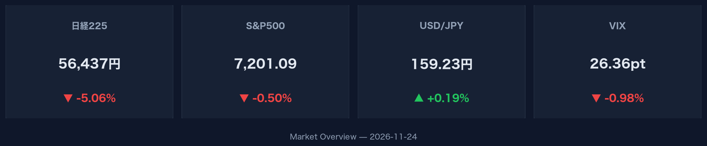
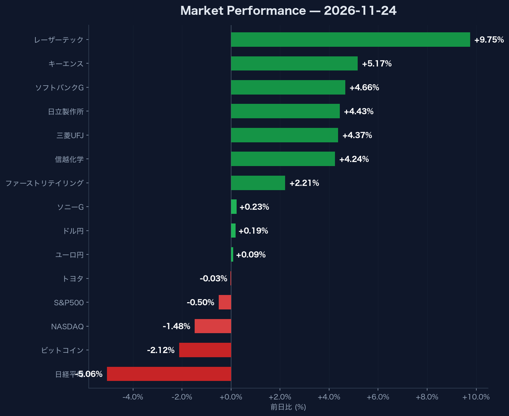

## この記事で分かること

- **指数全体の大幅下落と主力個別銘柄の急騰が同時に起きた市場の歪みを正確に把握する方法**
- **米国ハイテク安・金利低下・ドル円159円台が同時進行するマクロ環境の解釈**
- **表面的な指数ニュースに惑わされず個別銘柄のデータから需給を見極める判断基準**

---

## 指数急落時でも「日経平均の表面的な数値」に惑わされてはいけない理由

日経平均株価が前日比-5.06%（56,436.65）と大幅に下落した局面でも、個別主力銘柄のデータを見ると全く異なる構造が見えてきます。

表面的な指数だけを監視していると市場全体でパニック売りが発生しているように見えますが、実態は主力主要銘柄に対する大幅な買戻しの動きが確認できます。

| 銘柄名 | 終値 | 前日比 |
| :--- | :--- | :--- |
| レーザーテック | 33,200.00 | +9.75% |
| キーエンス | 14,750.00 | +5.17% |
| ソフトバンクG | 3,166.00 | +4.66% |
| 日立製作所 | 4,974.00 | +4.43% |
| 三菱UFJ | 3,156.00 | +4.37% |
| 信越化学 | 5,459.00 | +4.24% |
| ファーストリテイリング | 84,040.00 | +2.21% |
| ソニーG | 4,322.00 | +0.23% |
| トヨタ | 3,311.00 | -0.03% |

出典：[2026-11-24 市場ブリーフィング]

上記データの通り、レーザーテックが+9.75%と急伸したのを筆頭に、主要テック株や大型株が揃って大幅高となっています。指数の下落率だけで市場全体のセンチメントを判断すると、このような個別銘柄の強力な買戻しシグナルを見落とす危険があります。

:::message
**重要な判断基準**
日経平均株価などの価格採用型指数は、特定銘柄の値動きや特殊な要因で全体数値が大きく歪むことがあります。指数が急落した際こそ、個別主力銘柄の騰落率データを確認して市場の実質的な需給を分析してください。
:::

---

## 米国ハイテク安と金利低下が示すマクロ環境を見極める方法

米国市場におけるリスクオフの波及と債券市場への資金逃避のデータを正しく分解して把握することが重要です。

米国株式市場ではハイテク株が重荷となり、NASDAQが前日比-1.48%（23,733.54）、S&P500が前日比-0.50%（7,201.09）と主要指数が揃って下落しました。この背景にはリスク回避の動きが存在しますが、金利や為替の動きは単一の方向性を示していません。

:::details 米国マクロ指標および暗号資産の詳細データ
- **NASDAQ終値**: 23,733.54（前日比 -1.48%、出来高: 8,107,228,000）
- **S&P500終値**: 7,201.09（前日比 -0.50%、出来高: 3,323,599,000）
- **VIX指数**: 26.36（前日比 -0.98%）
- **米10年国債利回り**: 4.90（前日比 -0.28%）
- **ドル円**: 159.23（前日比 +0.19%）
- **ユーロ円**: 174.53（前日比 +0.09%）
- **ビットコイン（BTC-USD）**: 59,910.90（前日比 -2.12%、出来高: 32,983,697,408）
:::

株式市場の下落に伴い米10年国債利回りは4.90（-0.28%）へ低下しており、債券への買戻しが確認できます。一方で、恐怖心理を示すVIX指数は前日比-0.98%の26.36と落ち着きを見せており、為替市場でもドル円が159.23（+0.19%）とややドル高・円安傾向を維持しています。暗号資産市場ではビットコインが-2.12%下落して59,910.90となり60,000ドル台を割り込むなど、リスク資産間でも資金の選別が進んでいます。

---

## 指数と個別の乖離からトラップを見破るための落とし穴

市場データにおける「指数の数字」と「個別銘柄の体感」が乖離しているときは、構造的な売買の存在を疑う必要があります。

日経平均が-5.06%と大きく売り込まれる中で主力銘柄が買われている状況は、指数連動型ファンドやリバランスによる機械的な売却と、個別ファンダメンタルズに基づく買いが交錯していることを示します。

エンジニアリング視点でデータを分析する際は、単一の集計値（平均値）に頼るのではなく、構成要素の分布を確認することが鉄則です。投資判断においても、指数という単一データポイントだけを理由に売買を実行することは避けるべきです。

---

## まとめ

- **日経平均が-5.06%（56,436.65）と急落する一方、レーザーテック（+9.75%）やキーエンス（+5.17%）などの主力銘柄は大幅高となった**
- **米国市場ではNASDAQ（-1.48%）を中心にハイテク株が重荷となるも、米10年債利回りは4.90（-0.28%）へ低下しドル円は159.23（+0.19%）と円安傾向を維持した**
- **ビットコインは-2.12%の59,910.90と60,000ドル台を維持できず、リスク資産ごとの選別が進行している**

**次に何をすべきか**
保有銘柄や監視銘柄の板・出来高データを確認し、本日の指数急落が「市場全体の解体」なのか「指数構成の歪みによる一時的乖離」なのかを銘柄ごとに切り分けて分析してください。
