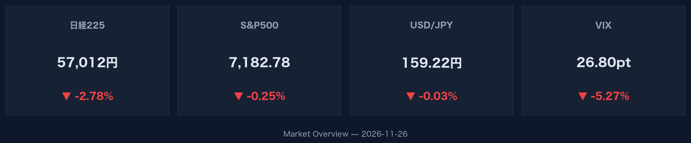
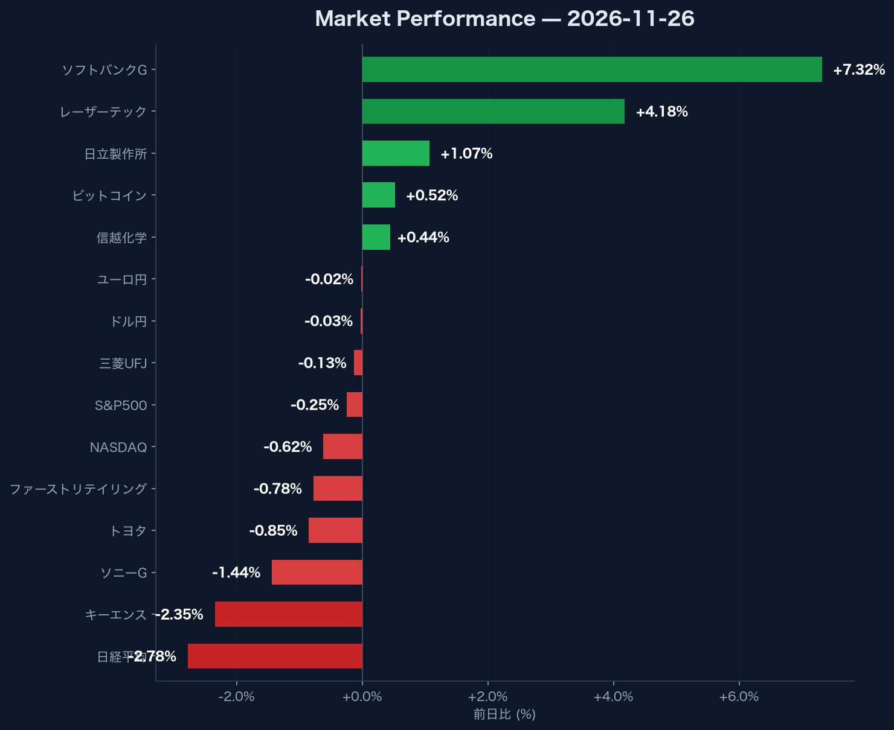

# 日経平均1,626円安でもソフトバンクGが+7.32%急騰した理由：二極化市場で見るべき主要指標と個別動向【2026/11/26】

## この記事で分かること
- **日経平均-2.78%急落時における主要株価指数とVIX指数の正確な水準**
- **ドル円・米10年債利回り・ビットコインなど関連マクロ指標の最新値**
- **キーエンス急落 vs ソフトバンクG・レーザーテック急騰に見る個別銘柄の二極化構造**

## 指数全面安の中で市場の警戒感が変化した理由
結論から言うと、日経平均をはじめ日米の主要指数が下落する一方でVIX指数は低下しており、パニック売りとは異なる質の下落であることが分かります。

日経平均株価は前日比-2.78%（-1,626.89相当）下落し、57,011.62で取引を終えました。出来高は199,100,000株を記録しています。米国市場においても、S&P500が7,182.78（-0.25%）、NASDAQ総合指数が23,585.80（-0.62%）と共に軟調な推移となりました。

なぜこれが重要かというと、株価指数の下落幅だけで市場のリスク度合を判断すると、本質的なボラティリティを見誤る危険があるからです。事実、市場の不確実性を示すVIX指数は前日比-5.27%低下し、26.80となっています。指数そのものは大幅調整となったものの、市場全体のボラティリティ警戒感はやや後退していることが数値から読み取れます。

:::message
日経平均が-1,626.89相当と大きく下げた一方で、VIX指数が-5.27%低下して26.80となった点に注目してください。価格の下落率と市場心理の指標を切り分けて分析することが重要です。
:::

## 為替・金利・暗号資産からマクロ環境を把握する方法
結論として、米金利の下落と微幅な円高推移が進行する中、暗号資産市場は底堅い動きを見せています。

為替市場では、ドル円が159.22（-0.03%）、ユーロ円が174.55（-0.02%）と微幅な円高推移となりました。また、米10年国債利回りは前日比-1.14%低下し、4.85%となっています。暗号資産市場では、ビットコインが60,694.56ドルと前日比+0.52%の上昇を記録しました。

なぜこれが重要かというと、株式市場以外の資金の流れ（金利・為替・暗号資産）をチェックすることで、市場全体の流動性環境を多角的に把握できるからです。米10年債利回りが4.85%へ低下する環境下で、ビットコインが60,694.56ドル（+0.52%）とプラス圏を維持している事実は、リスク資産間でも資金の選別が進んでいることを示しています。

:::details 為替・金利・暗号資産の主要データ一覧
- ドル円: 159.22 (-0.03%)
- ユーロ円: 174.55 (-0.02%)
- 米10年
